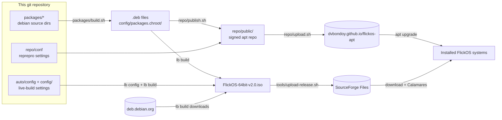

# 01 – Overview

## What FlickOS is

| Property | Value |
|---|---|
| Version | 2.0 (1.x was based on Ubuntu 20.04/LXLE; no in-place upgrade) |
| Base | Debian 13 "trixie", `amd64` only |
| Desktop | labwc (Wayland compositor, Openbox-style) + waybar, sfwbar (Cupertino's dock, Traditional's bottom panel), mako, fuzzel, foot, Thunar. Three desktop layouts, switchable live from *Settings → Desktop Layout & Style*: **Redmond** (default, one bottom panel), **Cupertino** (top bar and auto-hiding dock), **Traditional** (top panel, and window list with 4 desktops) |
| Look | **Arc-Dark** everywhere by default: GTK theme (arc-theme), Numix-Circle icons, and the same palette for panel, terminal, launcher, notifications, window borders, boot menus, boot splash and installer. A **Light** style (Arc, Numix-Circle-Light) recolors the desktop live; boot menus, splash and installer stay Arc-Dark. GTK details in *Settings → Appearance* (nwg-look). Translucent panel and terminal (no blur) |
| Audio | PipeWire + WirePlumber |
| Network | NetworkManager + nm-applet |
| Apps | Firefox ESR (with uBlock Origin), LibreOffice, VLC, Mousepad, Ristretto, Evince, Xarchiver, GNOME PackageKit (software manager); Bluetooth, printing, Flatpak (Flathub) |
| Updates | Automatic updates (unattended-upgrades): Debian's security fixes and stable updates, and FlickOS's own packages |
| Security | Firewall (ufw) on by default: incoming blocked, outgoing allowed |
| Branding | The halo logo and the brand amber (boot menus, boot splash, installer, artwork; the desktop keeps Arc's blue), FlickOS boot menu on the ISO and on installed systems (GRUB theme), boot splash (Plymouth), `os-release` variant and login banner, fastfetch logo; `ID=debian` kept |
| Login | Graphical login screen on installed systems (greetd + gtkgreet, `flickos-greeter`), optional automatic login. The live session logs in automatically on tty1 |
| Installer | Calamares with FlickOS branding (`flickos-installer`) |
| Image | `FlickOS-64bit-v2.0.iso`: hybrid ISO, boots on BIOS (syslinux) and UEFI (GRUB); can be written to USB |
| Published at | ISOs: SourceForge Files. Apt repository: https://dvbondoy.github.io/flickos-apt/. Code: GitHub `dvbondoy/FlickOS` |

## The big picture

A distribution is mostly **a selection of packages plus some configuration**.
FlickOS doesn't compile its own software. It combines Debian's packages with
a few small packages of its own.



There are two delivery paths, and you need both:

1. **The ISO** is how people *get* FlickOS. It contains a snapshot of every package.
2. **The apt repository** is how installed systems get *updates* to FlickOS's own
   packages. Debian's packages keep updating from Debian's servers as usual.

That's why customizations go into `.deb` packages and not straight into the
image: a file copied straight into the image never changes again after
installation.

## Repository layout

```
flickos/
├── README.md                     Start here
├── LICENSE                       GPL-3.0
├── docs/                         This documentation
│
├── auto/                         live-build "auto" scripts
│   ├── config                    ALL live-build options (distribution, bootloaders, ISO name…)
│   └── clean                     Cleans build output AND generated config
│
├── config/                       live-build input (hand-written parts)
│   ├── package-lists/            Which packages go into the image
│   ├── hooks/normal/             Shell scripts run inside the image during build
│   ├── bootloaders/              ISO boot menu: splash images, entry names, timeouts
│   └── packages.chroot/          (generated, git-ignored) local .debs to install
│
├── packages/                     FlickOS's own Debian packages
│   ├── build.sh                  Builds all of them into config/packages.chroot/
│   ├── flickos-desktop/          Meta-package: the whole desktop as dependencies
│   ├── flickos-settings/         Desktop config: session, keybindings, menu, panel, theme, wallpaper
│   ├── flickos-layouts/          Desktop layouts, wallpapers + the flickos-layout tool (and its unit tests)
│   ├── flick-tiler/              Opt-in window tiling on top of labwc (daemon + panel button)
│   ├── flickos-shortcuts/        Keyboard shortcut sheet while Super is held (daemon + GTK sheet)
│   ├── flickos-control/          The Settings window (pages over flickos-layout, flick-tiler, flickos-shortcuts)
│   ├── flickos-software/         Software: install and remove Debian, FlickOS, community and Flathub apps (window + Flatpak update timer)
│   ├── flickos-style-seven/      Seven, an opt-in extra style (light, see-through blue title bars and panel); shown under Software's Styles
│   ├── flickos-style-aye3/       Aye3wm, an opt-in extra style with its own layout (slate blue title bars, one black bar with desktop numbers)
│   ├── flickos-style-footprint/  Footprint, an opt-in extra style with its own layout (black top bar, round title buttons, a dock on the left)
│   ├── flickos-style-elemental/  Elemental, an opt-in extra style with its own layout (light windows, see-through top bar with Applications, a light dock, close left, maximize right)
│   ├── flickos-greeter/          Login screen of installed systems (greetd + gtkgreet)
│   ├── flickos-countme/          Anonymous weekly count (version + install age; PRIVACY.md)
│   ├── flickos-recovery/         Restore points: a btrfs snapshot before every software change, putting one back
│   ├── waypaper/                 Wallpaper picker (upstream waypaper, not in Debian trixie)
│   ├── sfwbar/                   Cupertino's dock, Traditional's window list and desktops (upstream sfwbar, compiled; not in Debian trixie)
│   ├── flickos-installer/        Calamares config + branding, live-session menu
│   ├── flickos-branding/         Logo icons, boot splash theme, installed GRUB theme, OS name, login banner, FlickOS version (flickos-release)
│   └── flickos-archive-keyring/  Public key + apt source for the FlickOS apt repo
│
├── server/countme/               Cloudflare Worker that counts flickos-countme's requests (not packaged)
├── server/store/                 Cloudflare Worker that serves Software's shelves (featured.json; not packaged)
│
├── tools/                        Developer scripts
│   ├── build-iso.sh              Clean + build packages + build ISO
│   ├── test-iso.sh               Boot the ISO / install / installed disk in a QEMU window
│   ├── boot-test.py              Headless boot test (also runs in CI)
│   ├── upload-release.sh         Upload ISO + SHA256SUMS to SourceForge Files
│   ├── check-palette.py          Checks every config file uses the Arc-Dark palette
│   ├── check-menus.py            Checks the installed and live root menus are in sync
│   ├── make-layout-previews.sh   Generates the desktop layout chooser previews
│   ├── make-fastfetch-logo.py    Generates the fastfetch logo from flickos.svg
│   └── make-placeholder-art.sh   Generates the installer, boot menu and boot splash images
│
├── repo/                         apt repository tooling
│   ├── conf/                     reprepro configuration (trixie, trixie-community) + DEP-11 hook (dep11.py)
│   ├── community/                Other developers' apps: the list (apps/), checks, build, publish
│   ├── new-key.sh                One-time: create the signing key
│   ├── publish.sh                Build packages and add them to the repo
│   ├── upload.sh                 Push the repo to dvbondoy.github.io/flickos-apt
│   ├── db/                       (generated, git-ignored) reprepro database
│   └── public/                   (generated, git-ignored) the repo to upload
│
├── .test-vm/                     (generated, git-ignored) test-iso.sh disk + UEFI vars
├── boot-test/                    (generated, git-ignored) boot-test.py serial log + screenshot
│
└── .github/workflows/
    ├── iso.yml                   CI: builds the ISO on every push
    ├── community.yml             CI: builds and checks community apps whose file changed
    └── discord.yml               posts pushes to main and tags to Discord
```

Files and folders that `lb config` and `lb build` create (`config/binary`,
`config/common`, `chroot/`, `binary/`, `cache/`, `.build/`, `*.iso`, …) are
git-ignored. Never edit them by hand. They are regenerated on every build.

## Boot and session flow

What happens when someone boots the ISO:

1. **Bootloader:** syslinux (BIOS) or GRUB (UEFI) shows the FlickOS boot menu
   (`config/bootloaders/`) and, after 10 seconds, loads the kernel with the
   options from `--bootappend-live` in `auto/config`:
   `boot=live components quiet splash username=user hostname=flickos`.
   `splash` makes Plymouth show the FlickOS boot splash.
2. **live-boot** (in the initramfs) finds the compressed root filesystem
   (`live/filesystem.squashfs`) on the ISO and mounts it with a writable
   RAM overlay. Changes are lost on reboot.
3. **live-config** runs early in boot. It creates the user `user` (password
   `live`) and sets the hostname to `flickos`.
4. **live-config-systemd**'s getty generator sees `boot=live` and writes
   autologin settings for tty1–6 to `/run`, which lives in RAM only.
5. `user` is logged in automatically on tty1. The login shell reads
   `/etc/profile.d/95-flickos-session.sh` (from `flickos-settings`), which on
   tty1 only runs `flickos-session`. That puts the FlickOS config directories
   first in `XDG_CONFIG_DIRS`, runs `flickos-layout prepare` to generate the
   desktop layout's and style's files in `$XDG_RUNTIME_DIR/flickos/xdg` (which
   goes first of all), passes the keyboard layout to labwc, and runs
   `exec labwc`.
6. **labwc** reads `rc.xml`, `menu.xml`, `environment` and `autostart`. The
   autostart runs `/usr/libexec/flickos/autostart`, which starts the wallpaper,
   the panel and notifications (`flickos-layout panel`, which runs mako and
   waybar for the chosen layout and style), tray applets, polkit agent,
   clipboard history, night light,
   and (installed systems only) screen lock/idle.
7. Right-clicking the desktop opens the root menu. In the live session it comes
   from `flickos-installer` and starts with **Install FlickOS**, which runs
   `flickos-install` → Calamares. Calamares removes `flickos-installer` from the
   installed system, so the entry is gone there.

Details of every piece: [09 – Customizing](09-customizing.md).

On an **installed** system there is no getty autologin. Instead the login
screen appears on VT 7: **greetd** (enabled as `display-manager.service`)
runs gtkgreet in the cage kiosk compositor (`flickos-greeter`). After the
password it starts `flickos-session`, and the flow continues from step 5.
If the user chose *Log in automatically* in the installer, they are in the
group `autologin` and greetd logs them in once per boot without asking. The
login screen never runs in the live session (its systemd drop-in has
`ConditionKernelCommandLine=!boot=live`). tty1 keeps a text login, which
starts the same session.

## Where to change what

| I want to… | Change | Doc |
|---|---|---|
| Add or remove an app for everyone | `packages/flickos-desktop/debian/control` | [04](04-packages.md) |
| Change keybindings, menu, startup programs, panel, theme, default wallpaper | `packages/flickos-settings/` | [09](09-customizing.md) |
| Add or change a desktop layout, or change the default layout | `packages/flickos-layouts/` | [09](09-customizing.md#desktop-layouts) |
| Change the Dark/Light styles, or add a style | `packages/flickos-layouts/usr/share/flickos/styles/`, labwc themes in `packages/flickos-settings/usr/share/themes/` | [09](09-customizing.md#styles-darklight) |
| Change the Seven style (an opt-in package), or publish another style package | `tools/make-seven.py` writes `packages/flickos-style-seven/` (and its metainfo, Software's style form); its colors in `tools/check-palette.py`'s `ALLOWED_SEVEN` | [04](04-packages.md#flickos-style-seven) |
| Change the Footprint style or its layout | `tools/make-footprint.py` writes the style, window theme with its buttons, wallpaper and the layout's preview; the layout's config and dock by hand in `packages/flickos-style-footprint/usr/share/flickos/layouts/footprint/`; its colors in `ALLOWED_FOOTPRINT` | [04](04-packages.md#flickos-style-footprint) |
| Change the Elemental style or its layout | `tools/make-elemental.py` writes the style, window theme with its buttons, wallpaper and the layout's preview; the layout's config and dock look by hand in `packages/flickos-style-elemental/usr/share/flickos/layouts/elemental/` (the dock's behavior is Cupertino's `dock.config`); its colors in `ALLOWED_ELEMENTAL` | [04](04-packages.md#flickos-style-elemental) |
| Change the Aye3 style or its layout | `tools/make-aye3.py` writes the style, themerc, wallpaper and the layout's preview; the layout's config is by hand in `packages/flickos-style-aye3/usr/share/flickos/layouts/aye3/`; its colors in `ALLOWED_AYE3` | [04](04-packages.md#flickos-style-aye3) |
| Change the default wallpaper (one per style), or the Wallpaper app (waypaper) | `packages/flickos-layouts/usr/share/flickos/styles/ID/wallpaper.png`, `packages/waypaper/` | [09](09-customizing.md#wallpaper) |
| Change window tiling (arrangements, keys, apps that float) | `packages/flick-tiler/` (`MODES`, `KEYBINDS`, `etc/xdg/flickos/tiler.conf`), Super+T in `packages/flickos-settings/etc/xdg/labwc/rc.xml` | [09](09-customizing.md#window-tiling) |
| Change the hold-Super shortcut sheet (descriptions, hold time, look) | `packages/flickos-shortcuts/` (`COMMANDS`, `ACTIONS`, `HOLD_MS`, `usr/share/flickos/shortcuts/style.css`) | [09](09-customizing.md#shortcut-sheet-hold-super) |
| Put a program that isn't a FlickOS package on the desktop (keys, panel button) | an add-on folder read by `packages/flickos-layouts/` (`addons()`, `addon_fragments`, `use_addons`) | [09](09-customizing.md#add-ons) |
| Change the Settings window (pages, tiles for other apps, mouse/touchpad/keyboard options) | `packages/flickos-control/usr/bin/flickos-control` (`PAGES`, `TILES`, `SETTINGS`); *All Settings* in both menus | [09](09-customizing.md#settings-window) |
| Change mouse, touchpad, keyboard or idle defaults for everyone | `packages/flickos-control/etc/xdg/flickos/input.conf`, `keyboard.conf`, `idle.conf` | [09](09-customizing.md#settings-window) |
| Change the start menu (pinned apps, sections, look, on or off for everyone) | `packages/flickos-menu/` (`etc/xdg/flickos/menu.conf`, `SECTIONS`, `style.css`), live pins in `packages/flickos-installer/etc/xdg/flickos-live/flickos/menu.conf`, `Launcher=` in flickos-layouts' `layouts.conf` | [09](09-customizing.md#start-menu) |
| Change how pop-ups fade (durations, which windows, the reverse when shown again) | `packages/flickos-menu/` (`FADE_IN_MS`, `FADE_OUT_MS`, `fade_opacity`, `Fader`, `View.fades`), the shortcut sheet's copy in `packages/flickos-shortcuts/` (`Sheets`; the same durations and curve, a test checks), VIS-5 in `docs/hig/06-visual-style.md` | [design](design/flickos-fades.md) |
| Change Quick Settings (its switches and sliders, the programs they run, the icons that open it, on for everyone) | `packages/flickos-menu/usr/share/flickos/menu/quick.py` (`QUICK_TILES`, `QUICK_READS`, `change_command`), `.flickos-quick` in its `style.css`; the panel side in `packages/flickos-layouts/` (`use_quick_settings`, `QUICK_KEY`, `Quick=` in `layout.ini`, `QuickSettings=` in `layouts.conf`) | [09](09-customizing.md#quick-settings) |
| Change what a click on the desktop does | `flickos-layout` (`CLICKS`), `packages/flickos-settings/etc/xdg/labwc/rc.xml` (`<mouse>`) | [09](09-customizing.md#desktop-clicks) |
| Change the Desktop Layout & Style chooser or its previews | `packages/flickos-layouts/usr/bin/flickos-layout` (`pick`), `tools/make-layout-previews.sh` | [09](09-customizing.md#the-chooser) |
| Change Software (the app list, sources, categories, installing and removing, Flatpak updates) | `packages/flickos-software/` (`CATEGORIES`, `SOURCES`, `APT_ORIGINS`, `SAME_APPS`, `merge`, `apt_plan`/`flatpak_plan`, `PROTECTED_PREFIXES`, `usr/libexec/flickos/software-update`, `etc/apt/apt.conf.d/50flickos-software`) | [design](design/flickos-software.md) |
| Change Software's front page shelves (Made for FlickOS, Apps to start with) | `packages/flickos-software/usr/share/flickos/software/featured.json`, then deploy `server/store/` | [store server](../server/store/README.md) |
| Accept, update or remove another developer's app | `repo/community/apps/NAME`, `repo/community/publish.sh`; the rules in `repo/community/check.py` | [community](../repo/community/README.md) |
| Change the welcome window, or stop it at a new account's logins | `packages/flickos-welcome/` (`CARDS`, `etc/xdg/flickos/welcome.conf`, `etc/skel/.config/flickos/welcome`); the chooser on its own is flickos-layouts' `choose-layout` and `flickos-layout first-run` | [09](09-customizing.md#first-login) |
| Change the phone connection (what a phone may send, notifications, calls, browsing its files, media control, what the phone plays, named commands, ports, on for everyone, Send to Phone in the file manager) | `packages/flickos-phone/` (`INCOMING`/`OUTGOING` and `capabilities()`, `on_share`, `menu_entries`, `etc/xdg/flickos/phone.conf`), Send to Phone in Thunar in `packages/flickos-settings/etc/xdg/flickos/Thunar/uca.xml`, its panel button in `packages/flickos-layouts/` (`custom/phone` in `common/modules.jsonc` and `base.css`, `use_phone`), its autostart line in `packages/flickos-settings/usr/libexec/flickos/autostart`, the *Phone* page in `packages/flickos-control/` (`PhonePage`) | [design](design/flickos-phone.md) |
| Change screen zoom (keys, whole screen or lens, zoom steps) | `<magnifier>` and the Zoom keys and Super+scroll in `packages/flickos-settings/etc/xdg/labwc/rc.xml`, their descriptions in `packages/flickos-shortcuts/` (`ACTIONS`, `BUSY_SIGNAL`), the user's settings in `packages/flickos-control/` (`zoom.*` in `SETTINGS`, `magnifier_options`, `AccessibilityPage`, conffile `etc/xdg/flickos/zoom.conf`) | [design](design/flickos-zoom.md) |
| Change screenshots and recordings (keys, the capture bar, the frozen screen, where they are saved, the recording's pipeline, the portal's screen chooser, the panel's recording button, the settings) | `packages/flickos-screenshot/` (`DELAYS`, `FOLDER`, `NOTICES`, `FrozenScreen`, `pipeline_description`, `Recorder`, `get`/`set`, `etc/xdg/flickos/screenshot.conf`, `usr/libexec/flickos/screencast-chooser`), the *Screenshots* page in `packages/flickos-control/` (`ScreenshotsPage`), `custom/recording` in `packages/flickos-layouts/usr/share/flickos/layouts/common/modules.jsonc`, the keys in `packages/flickos-settings/etc/xdg/labwc/rc.xml` and their descriptions in `packages/flickos-shortcuts/` (`COMMANDS`) | [design](design/flickos-screenshot.md) |
| Change installer branding or behavior | `packages/flickos-installer/` | [09](09-customizing.md#installer) |
| Change restore points (when one is taken, how many are kept, putting one back, the apt hook, the boot menu, recovering after failed starts, the login notification, the Settings page, the installer's btrfs layout) | `packages/flickos-recovery/` (`KEEP`, `MIN_FREE`, `create`, `restore`, `LIMIT`, `GOOD_SECONDS`, `etc/apt/apt.conf.d/80flickos-recovery`, `etc/grub.d/42_flickos-recovery`, `usr/share/initramfs-tools/`, the `flickos-recovery-*.service` units, `usr/libexec/flickos/recovery-helper`), the `notify` line in `packages/flickos-settings/usr/libexec/flickos/autostart`, the *Restore Points* page in `packages/flickos-control/` (`RestorePointsPage`, `recovery_available`), the layout in `packages/flickos-installer/etc/calamares/modules/mount.conf` and `partition.conf` | [design](design/flickos-recovery.md) |
| Change the anonymous weekly count (what is sent, the server, the installer's notice) | `packages/flickos-countme/`, `server/countme/`, `PRIVACY.md`, the first slide of `branding/flickos/show.qml` in flickos-installer | [09](09-customizing.md#weekly-count) |
| Add a package only to the live ISO (not installed systems) | `config/package-lists/live.list.chroot` | [03](03-live-build-config.md) |
| Enable a systemd service in the image | `config/hooks/normal/0100-services.hook.chroot` | [03](03-live-build-config.md) |
| Change bootloader, kernel boot options | `auto/config` | [03](03-live-build-config.md) |
| Change the FlickOS version (ISO name, os-release, …) | `packages/flickos-branding/usr/lib/flickos-release` + installer `branding.desc` | [06](06-ci-and-releases.md#the-version-number) |
| Change the boot menu (ISO and installed), boot splash, logo, OS name, firewall | `config/bootloaders/`, `packages/flickos-branding/`, `config/hooks/normal/0200-firewall.hook.chroot` | [09](09-customizing.md#boot-menu) |
| Change the apt repo URL (e.g. to flickos.net) | `packages/flickos-archive-keyring/etc/apt/sources.list.d/flickos.sources` | [05](05-apt-repository.md#moving-the-repository-eg-to-flickosnet) |
| Ship an update to installed systems | bump version, `repo/publish.sh`, `repo/upload.sh` | [05](05-apt-repository.md) |
| Make a release | tag `vX.Y` | [06](06-ci-and-releases.md) |
